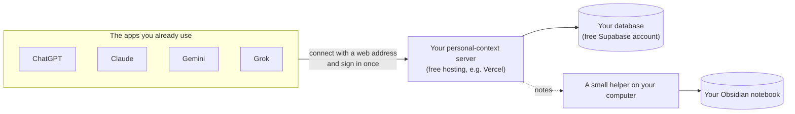

# personal-context-mcp

**One shared memory for ChatGPT, Claude, Gemini and Grok, and a tidy Obsidian notebook built from it.**

Most people who use AI a lot have the same problem. You explain your project to ChatGPT on Monday,
to Claude on Tuesday and to Gemini on Wednesday. Each app remembers a little, none of them remembers
what the others were told, and years of useful conversations sit in four separate apps you can't search
together.

personal-context-mcp fixes that. It's a small server **you** own, and all four apps connect to it:

- **Tell one app, and all of them know.** Decisions, preferences, projects, to-do lists and files are
  saved in one place that every app reads from and writes to.
- **Your old chats become useful.** Import your chat history from all four apps, and it's sorted into
  projects and topics automatically. The important parts are pulled out properly.
- **You get a real notebook.** An [Obsidian](https://obsidian.md) vault is filled with clean, linked
  notes and "map" pages for your topics, not thousands of raw transcripts.
- **It's yours.** Your data lives in a database in your own account. Nobody else, including the authors
  of this project, can see it.

It isn't another chat app. You keep using the ChatGPT, Claude, Gemini and Grok apps you already have,
on your phone and on the web. This sits underneath them.

---

## How it works, in one picture



1. You put the server online. There are free options, and the guides walk you through every click.
2. You add its web address to each AI app as a "connector". Each app asks you to sign in with Google
   once, and only **your** Google account is allowed in.
3. From then on, the apps save important things as you talk and look them up when they're relevant.
   You can also just ask: *"What did we decide about the kitchen renovation?"*

---

## Is this for me?

**Yes, if** you use two or more of these AI apps regularly, and you're comfortable following a
step-by-step guide that includes copying and pasting a few commands. You don't need to be a
programmer. The guides explain every step, what you should see, and what to do if you see something
else.

**Maybe not yet, if** you only use one AI app. Its built-in memory may be enough.

**What you need:**

| | Why | Cost |
| --- | --- | --- |
| A computer (Mac, Linux or Windows with WSL) | To set things up. After that it can be off. | — |
| A Google account | The apps sign in to your server through Google. | Free |
| A [Supabase](https://supabase.com) account | Your database. | Free plan is enough to start |
| A [Vercel](https://vercel.com) account | Puts your server on the internet. | Free (personal use) |
| [Obsidian](https://obsidian.md) *(optional)* | The notebook app. | Free |
| A TypeSafe key *(optional)* | Cheaply sorts years of old chats. | Pay as you go |
| An Anthropic key *(optional)* | Reads your most important old chats closely and writes proper notes. | Pay as you go, with a cost estimate before anything runs |

Plan for **about an hour** the first time, most of it creating the free accounts.
See [Privacy and costs](docs/privacy-and-costs.md) for details.

---

## Get started

Follow the guides in order. Each one ends with a check that tells you it worked.

| Step | Guide | Time | Required? |
| --- | --- | --- | --- |
| 0 | [Before you start](docs/guides/00-before-you-start.md): what you'll end up with, and the few words worth knowing | 5 min | ✅ Read first |
| 1 | [Install the tools](docs/guides/01-install-the-tools.md) | 10 min | ✅ |
| 2 | [Try it on your computer](docs/guides/02-try-it-locally.md) | 10 min | Optional |
| 3 | [Create your Google sign-in](docs/guides/03-google-sign-in.md) | 10 min | ✅ |
| 4 | [Create your database](docs/guides/04-database.md) | 10 min | ✅ |
| 5 | [Put it online](docs/guides/05-put-it-online.md) | 15 min | ✅ |
| 6 | [Connect ChatGPT, Claude, Gemini and Grok](docs/guides/06-connect-your-ai-apps.md) | 5 min per app | ✅ |
| 7 | [Keep your secrets in 1Password](docs/guides/07-keep-secrets-in-1password.md) | 10 min | Optional |
| 8 | [Set up your Obsidian notebook](docs/guides/08-obsidian.md) | 10 min | Optional |
| 9 | [Import your old chats](docs/guides/09-import-your-history.md) | depends on how many | Optional |
| 10 | [Build your wiki: links and maps](docs/guides/10-build-your-wiki.md) | 10 min | Optional |
| 11 | [Gemini without custom apps](docs/guides/11-gemini-without-custom-apps.md) | 15 min | Only if on Gemini Plus/free |
| 12 | [Daily use: what to expect](docs/guides/12-daily-use.md) | 5 min | Read after connecting |

The quickest possible start, if you already have the tools:

```bash
git clone https://github.com/DanDo385/personal-context-mcp.git
cd personal-context-mcp
uv sync
uv run personal-context-mcp init      # answers a few questions and writes your settings to .env.local
```

**Where your settings go:** everything personal (addresses, keys, passwords) lives in one file,
`.env.local`, in the project folder. It's never uploaded to GitHub. `init` writes it for you; to
fill it in by hand, start from [`.env.local.example`](.env.local.example).

Stuck? Try [Troubleshooting](docs/troubleshooting.md), then the [FAQ](docs/faq.md). Words you don't
know are explained in the [Glossary](docs/glossary.md).

---

## What the AI apps can do with it

Once connected, each app gets tools like these (48 in total). It uses them on its own when your
request needs them, and you can also ask for them directly.

| You say... | What happens |
| --- | --- |
| "Remember that I'm vegetarian." | Saved as a preference every app will see. |
| "What did we decide about the database last month?" | Searches decisions and past conversations from **all** apps. |
| "Add oat milk to my shopping list." | Updates your real list, visible everywhere and in Obsidian. |
| "Save this chart to my research project." | Stores the file itself, not just its name, in your storage. |
| "Where did we leave the website redesign?" | Pulls the project's status, decisions and open tasks. |
| *(at the end of a useful chat)* | The app saves what was decided, in one step, without duplicates. |

The same abilities are packaged as [skills](skills/) for apps that support them, and a
[short custom instruction](instructions/shared.md) teaches every app when to use them.

---

## Privacy in one paragraph

Your conversations and notes live in **your** Supabase database and **your** Obsidian folder. Only the
Google account(s) you list can connect. Anything that looks like a password, key, ID number or card
number is kept on your computer and never sent to any outside service. You can choose to keep health,
legal and money-related conversations local too. The optional sorting (TypeSafe) and note-writing
(Anthropic) services only receive the text they need, after passwords and emails have been removed.
Full details: [Privacy and costs](docs/privacy-and-costs.md).

---

## For developers

- [Architecture and design](docs/architecture.md): the long-form design document covering sources of
  truth, the memory layers, the classifier and confidence policy, Obsidian sync, and the security model.
- [Deploy scripts](deploy/README.md) and [configuration reference](.env.example).
- [Contributing](CONTRIBUTING.md): running the tests, the database-backed test tier, and the checks
  every change must pass.

```bash
uv sync --all-groups
uv run ruff check src tests && uv run mypy src && uv run pytest
```

## License

[MIT](LICENSE)
